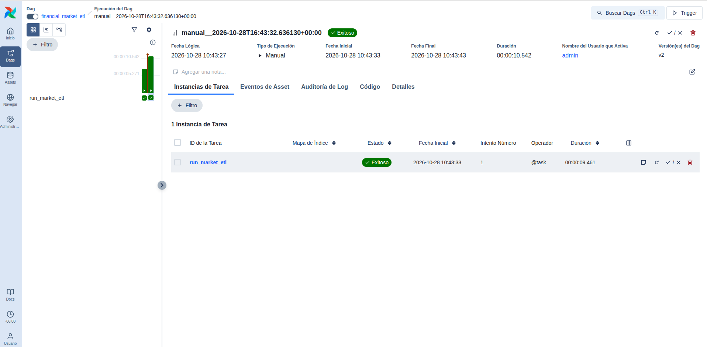
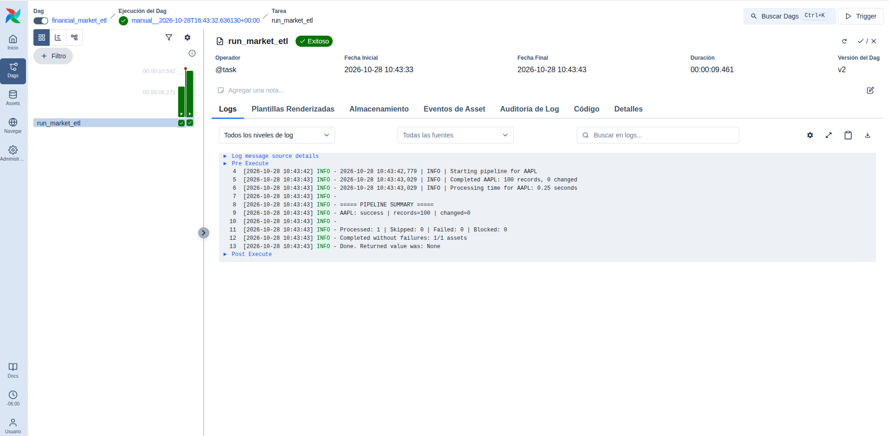

# Financial Market Data Pipeline

A modular financial market ETL pipeline built with Python, PostgreSQL, Docker, and Apache Airflow, featuring data quality validation, idempotent loading, API usage controls, and automated testing.

> **Project Status:** Active development — ETL pipeline and local Airflow orchestration implemented and validated. CI/CD automation and final portfolio documentation are planned.

## Project Overview

This project implements a reliable ETL pipeline for collecting, validating, and storing daily financial market data.

The system integrates with the Alpha Vantage API, preserves original JSON responses, transforms OHLCV data into structured records, and loads validated observations into PostgreSQL.

The pipeline supports both live API ingestion and offline replay of previously saved datasets.

Apache Airflow provides local workflow orchestration, execution history, task status tracking, and task logs.

## Business Problem

Financial analysts and data teams need reliable access to consistent historical market data.

Manual data collection introduces several risks:

- Inconsistent data formats
- Duplicate financial observations
- Missing or invalid OHLCV values
- Repetitive manual processing
- Limited execution traceability
- Uncontrolled usage of rate-limited APIs

This project addresses these challenges through modular ETL components, data quality checks, transactional loading, API usage controls, workflow orchestration, and automated tests.

## Architecture

```text
                  Alpha Vantage API
                          |
                          v
                   Python API Client
                          |
                          v
                    Raw JSON Storage
                          |
                          v
                  OHLCV Transformation
                   & Data Validation
                          |
                          v
                   PostgreSQL Database
                          |
                          v
                      SQL Analytics


                Apache Airflow
                      |
                      v
            Financial Market ETL DAG
                      |
                      v
              Python ETL Entry Point
                      |
                      v
               Pipeline Execution
                      |
                      v
                Task Status & Logs
```

The ETL components can also run independently from Airflow through the command-line interface.

### Pipeline Workflow

1. **Extract:** Retrieve daily market data from Alpha Vantage or load previously saved raw JSON files.
2. **Preserve:** Store original API responses for traceability and reproducibility.
3. **Transform:** Convert source observations into structured OHLCV records.
4. **Validate:** Check financial data quality before loading.
5. **Load:** Insert or update observations using transactional PostgreSQL UPSERT operations.
6. **Track:** Record per-asset processing outcomes and API ingestion metadata.
7. **Orchestrate:** Execute the existing ETL through Apache Airflow and inspect task logs.

## Technology Stack

| Technology | Purpose |
|---|---|
| Python 3.14 | Core ETL implementation |
| Requests | Financial API integration |
| pandas | Data transformation and validation |
| Decimal | Financial price precision |
| PostgreSQL 18 | Relational data storage |
| SQLAlchemy | Database connectivity and transactional loading |
| Docker Compose | Local PostgreSQL infrastructure |
| Apache Airflow 3.3.2 | Workflow orchestration and execution monitoring |
| Pytest | Unit and database integration testing |
| unittest | Airflow DAG unit testing |
| Ruff | Code linting and formatting |
| Git & GitHub | Version control and repository hosting |

## Implemented Features

### Data Extraction

- Alpha Vantage daily time-series ingestion
- Multi-asset processing
- Configurable stock symbol selection
- Original JSON response preservation
- Offline ingestion from saved raw datasets
- Per-asset error handling

### Data Quality and Storage

- OHLCV transformation and validation
- Chronological organization of financial observations
- Relational schema with integrity constraints
- Composite primary key for duplicate prevention
- Transactional PostgreSQL UPSERT operations
- Idempotent loading of unchanged records
- Database transaction integration tests

### API Usage Management

- Configurable ingestion freshness checks
- Successful-fetch metadata tracking
- Configurable refresh interval
- Local daily API request budget
- Atomic reservation of API requests
- Provider rate-limit detection
- Blocking of subsequent requests when the provider limit is reached
- Optional forced refresh without bypassing the local API budget

### Workflow Orchestration

- Apache Airflow DAG: `financial_market_etl`
- Task: `run_market_etl`
- Manual DAG execution
- Local offline ETL execution
- Execution history and task logs
- Task failure propagation through process exit codes
- Execution timeout configuration
- Restricted concurrency for local development
- Reusable Airflow startup script

### Testing and Quality

- 61 ETL unit and integration tests
- 4 Airflow DAG unit tests
- Automated Ruff linting and formatting checks
- Shell syntax validation for the Airflow startup script

## Data Model

### `daily_prices`

The primary analytics table stores daily financial market observations.

| Column | Description |
|---|---|
| `symbol` | Financial instrument identifier |
| `date` | Trading date |
| `open` | Opening price |
| `high` | Highest price |
| `low` | Lowest price |
| `close` | Closing price |
| `volume` | Trading volume |
| `updated_at` | Last database modification timestamp |

The composite primary key `(symbol, date)` prevents duplicate observations for the same financial instrument and trading date.

The UPSERT process updates records only when their stored values change, allowing repeated executions without unnecessary modifications.

### Operational Metadata

The pipeline also maintains operational information for API ingestion:

- `ingestion_state`: tracks successful API fetches by asset.
- `api_request_usage`: tracks and reserves requests against the configured daily API budget.

These tables support controlled ingestion and reduce unnecessary API consumption.

## Verified Results

The following results have been validated in the local development environment:

| Validation | Result |
|---|---|
| ETL tests | 61 passed |
| Airflow tests | 4 passed |
| Total automated tests | 65 passed |
| Ruff linting | Passed |
| Ruff formatting | Passed |
| Airflow DAG execution | Success |
| AAPL observations processed | 100 |
| Modified rows during repeat execution | 0 |
| Airflow task logs | Successfully captured |

The successful Airflow execution used offline AAPL data and confirmed that repeated loading does not modify unchanged database records.

A separate live API ingestion test confirmed that the pipeline responds to provider rate-limit errors and prevents additional requests after the provider limit is detected.

## Local Development

### Requirements

- Python 3.14
- Docker Engine
- Docker Compose
- Git
- Alpha Vantage API key for live extraction
- Apache Airflow 3.3.2 for local orchestration

### 1. Clone the Repository

```bash
git clone https://github.com/AlejandraGMejia/financial-market-data-pipeline.git
cd financial-market-data-pipeline
```

The repository must be accessible to the person cloning it. A private repository requires the appropriate GitHub permissions.

### 2. Configure the ETL Environment

Create and activate the Python virtual environment:

```bash
python3 -m venv .venv
source .venv/bin/activate
```

Install the project and development dependencies:

```bash
python -m pip install -e ".[dev]"
```

Create the local configuration file:

```bash
cp .env.example .env
```

Configure your own API key and PostgreSQL credentials in `.env`.

Never commit credentials or secrets.

### 3. Start PostgreSQL

On Fedora, start Docker if it is not already running:

```bash
sudo systemctl start docker
```

Start the PostgreSQL service:

```bash
sudo docker compose up -d postgres
```

Check the container status:

```bash
sudo docker compose ps
```

Wait until PostgreSQL reports a healthy status.

The database is exposed locally through:

```text
127.0.0.1:5433
```

Apply the required SQL schema files from the `sql/` directory before executing the pipeline in a new environment.

### 4. Run the ETL Pipeline

#### Offline ingestion

Replay previously saved AAPL market data:

```bash
python run_pipeline.py --source raw --symbols AAPL
```

This mode does not consume Alpha Vantage API requests.

Previously saved raw JSON files must be available locally.

#### Live API ingestion

Fetch market data using Alpha Vantage:

```bash
python run_pipeline.py --source api --symbols AAPL
```

Process multiple assets:

```bash
python run_pipeline.py --source api --symbols AAPL MSFT NVDA
```

Live ingestion is subject to the provider's API limits and the project's configured request budget.

#### Configure the refresh interval

```bash
python run_pipeline.py \
  --source api \
  --symbols AAPL \
  --refresh-hours 24
```

#### Configure the daily API request budget

```bash
python run_pipeline.py \
  --source api \
  --symbols AAPL \
  --daily-api-limit 5
```

#### Force a new API fetch

```bash
python run_pipeline.py \
  --source api \
  --symbols AAPL \
  --force
```

The `--force` option bypasses the freshness check but does not bypass the configured daily API request budget.

## Apache Airflow Orchestration

Apache Airflow orchestrates the existing ETL entry point rather than duplicating extraction, transformation, or loading logic.

### DAG Configuration

| Property | Configuration |
|---|---|
| DAG ID | `financial_market_etl` |
| Task ID | `run_market_etl` |
| Schedule | `None` |
| Catchup | Disabled |
| Maximum active DAG runs | 1 |
| Retries | 0 |
| Task execution timeout | 5 minutes |
| Subprocess timeout | 240 seconds |
| Ingestion source | Local raw JSON |
| Default asset | AAPL |

The DAG executes the equivalent of:

```bash
python run_pipeline.py --source raw --symbols AAPL
```

It launches the ETL through its dedicated Python virtual environment.

### Why Manual Scheduling?

The DAG currently uses `schedule=None` intentionally.

Manual execution allows validation of workflow orchestration, task logging, failure handling, and database idempotency without generating unnecessary financial API requests.

Automated live ingestion can be introduced later with scheduling decisions that respect provider quotas and data freshness rules.

### Airflow Environment

Airflow is maintained in a separate virtual environment:

```text
.venv-airflow/
```

This isolates Airflow's dependencies from the main ETL application.

The local Airflow environment must be installed and configured before using the startup script.

The current setup uses a local SQLite metadata database for Airflow development, separate from the PostgreSQL database used by the financial ETL.

### Start Airflow

With the PostgreSQL container running and the Airflow environment configured, execute:

```bash
./scripts/start_airflow.sh
```

The startup script configures the DAG directory, disables example DAGs, applies local resource limits, and launches Airflow Standalone.

Open the dashboard:

http://127.0.0.1:8080

Sign in using the credentials configured for the local Airflow instance.

Airflow Standalone is intended for local development and demonstration, not production deployment.

### Trigger the DAG

1. Open the Airflow dashboard.
2. Select `financial_market_etl`.
3. Enable the DAG if it is paused.
4. Trigger a manual run.
5. Inspect the `run_market_etl` task.
6. Review its status and logs.

The task invokes the existing ETL pipeline and propagates nonzero exit codes back to Airflow.

### Verified Airflow Execution

The DAG was successfully triggered from the Airflow dashboard on October 28, 2026.

The execution logs confirmed:

```text
Starting pipeline for AAPL
Completed AAPL: 100 records, 0 changed

AAPL: success | records=100 | changed=0

Processed: 1 | Skipped: 0 | Failed: 0 | Blocked: 0
Completed without failures: 1/1 assets
```

This validates orchestration of the offline ingestion process and idempotent behavior during repeated loading.

### Airflow Execution Evidence

The following screenshots demonstrate successful workflow orchestration and execution logging.

**Successful DAG execution**



The screenshot shows a manually triggered DAG run completed successfully, with the `run_market_etl` task marked as successful.

**ETL task execution logs**



The task logs confirm that AAPL data was processed successfully, with 100 observations and zero modified records during the repeated ingestion.

Both screenshots were captured during the successful manual execution of the `financial_market_etl` DAG.

## Testing

### ETL Unit Tests

```bash
python -m pytest -q
```

### Full ETL Test Suite

Run all ETL tests, including database integration tests:

```bash
RUN_DB_TESTS=1 python -m pytest -q
```

Database integration tests require a running PostgreSQL instance with the necessary schema.

### Airflow DAG Tests

Run the separate Airflow tests using its virtual environment:

```bash
.venv-airflow/bin/python -m unittest discover \
  -s airflow_tests \
  -p "test_*.py" \
  -v
```

These tests validate:

- DAG configuration
- Offline ETL command construction
- Missing virtual environment handling
- Subprocess failure propagation

They use mocks and do not make real API requests or load database records.

### Code Quality

Check linting:

```bash
python -m ruff check src tests airflow_tests dags run_pipeline.py
```

Check formatting:

```bash
python -m ruff format --check src tests airflow_tests dags run_pipeline.py
```

Validate the Airflow startup script:

```bash
bash -n scripts/start_airflow.sh
```

## Reliability and Design Decisions

### Idempotent Loading

The PostgreSQL UPSERT process avoids unnecessary updates when incoming records match existing observations.

This makes reruns safer and reduces redundant database modifications.

### Controlled API Consumption

The pipeline uses freshness checks and a local request budget to avoid unnecessary calls to a rate-limited financial API.

When a provider rate-limit response is detected, subsequent requests in the same pipeline execution are blocked.

### Error Propagation

The command-line entry point returns a nonzero exit code when an asset fails or is blocked.

Airflow invokes the command using `subprocess.run(..., check=True)`, allowing failed executions to be reflected in the task state.

### Separation of Responsibilities

- **ETL application:** extraction, transformation, validation, and loading.
- **Apache Airflow:** workflow orchestration and operational visibility.
- **PostgreSQL:** structured market data and ingestion metadata.
- **Docker Compose:** local database infrastructure.
- **Git and GitHub:** version control and project tracking.

## Development Roadmap

- [x] Project structure and Python environment
- [x] Financial API client
- [x] Raw data ingestion
- [x] OHLCV transformation and validation
- [x] PostgreSQL schema and data loading
- [x] Transactional UPSERT operations
- [x] Unit and database integration testing
- [x] Multi-asset ingestion
- [x] Incremental ingestion through freshness checks
- [x] API request budgeting and provider rate-limit handling
- [x] Operational ingestion metadata
- [x] Apache Airflow DAG implementation
- [x] Airflow execution and task log validation
- [x] Airflow DAG unit tests
- [x] Reusable local Airflow startup script
- [x] Airflow execution evidence
- [ ] GitHub Actions CI/CD automation
- [ ] Final architecture diagram and documentation
- [ ] Portfolio presentation and project report

## Security

API credentials and database passwords are provided through local configuration and environment variables.

The following should remain excluded from version control:

- `.env` and local secret files
- Python virtual environments
- Downloaded raw market datasets
- Airflow metadata and runtime files

The Airflow dashboard is configured for localhost access in the local development environment.

Real API keys and authentication passwords must never be included in commits, screenshots, or shared logs.

## Limitations

- The current Airflow DAG uses manual triggering rather than scheduled automated ingestion.
- The DAG relies on the project's local Python environments.
- Airflow Standalone and its local metadata database are for development and demonstration.
- A new installation requires separate Airflow environment setup.
- Offline replay requires previously saved raw data.
- Live API extraction is constrained by Alpha Vantage rate limits and the configured local request budget.
- Production deployment, alerting, and cloud infrastructure are outside the current implementation scope.

## Author

Data Engineering Portfolio Project — Project 02
