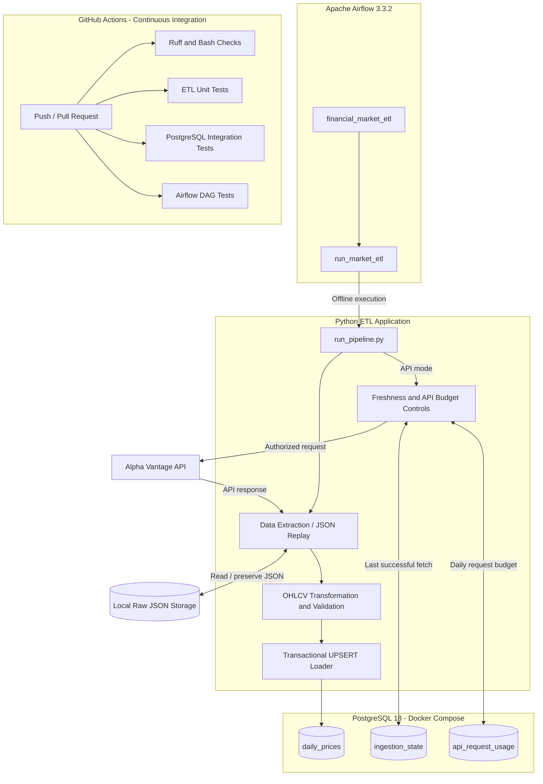
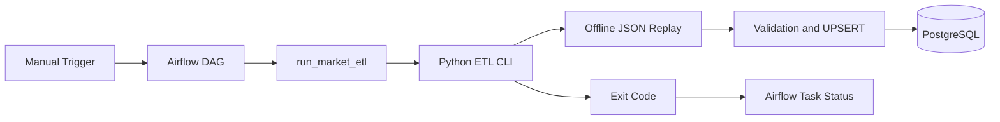
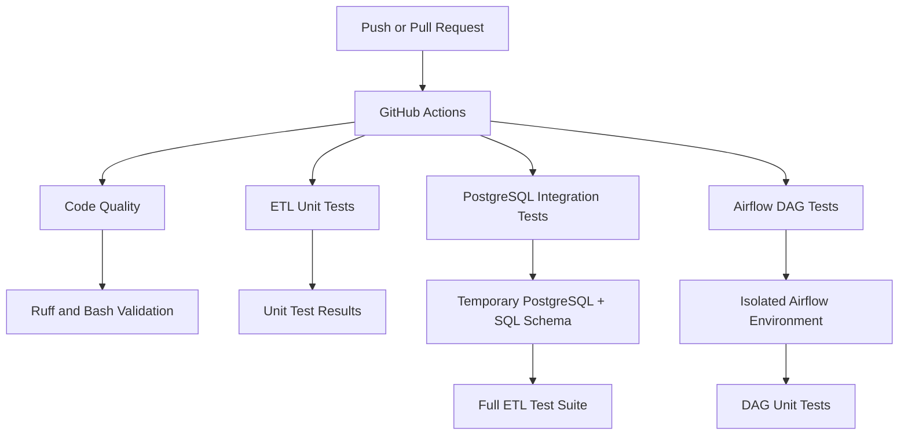
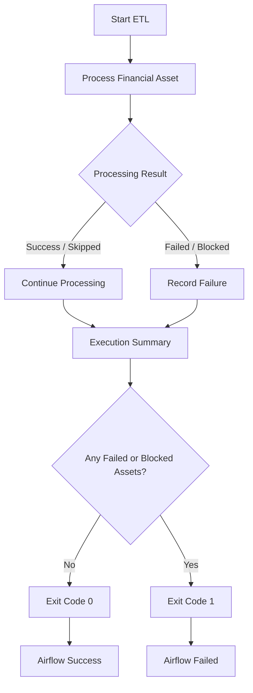
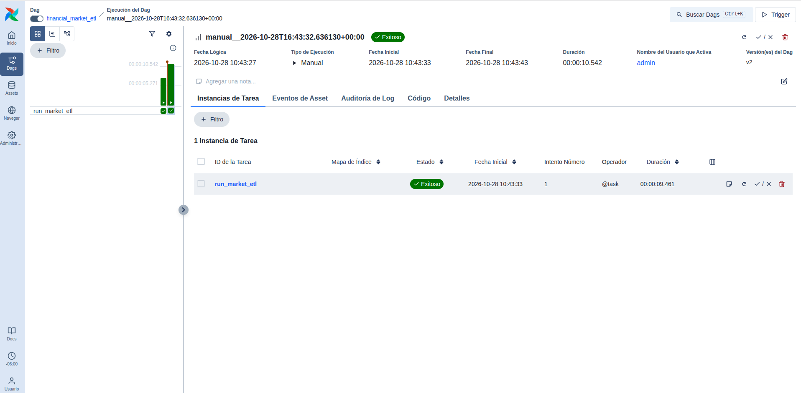
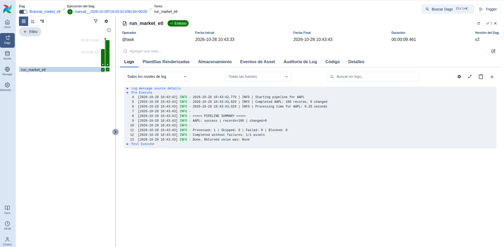
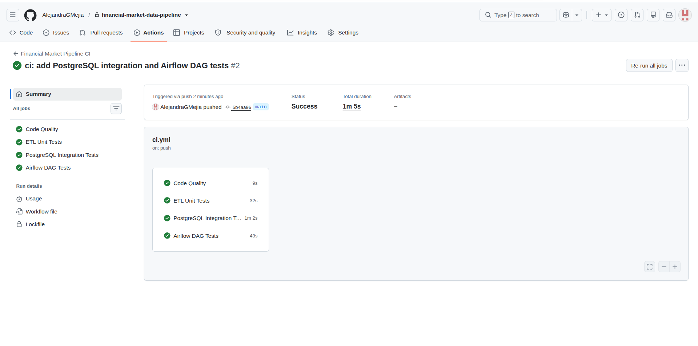

# System Architecture — Financial Market Data Pipeline

**Author:** Alejandra G. Mejía
**Project:** Data Engineering Portfolio — Project 02
**Status:** Implemented and validated locally and through CI
**Last Updated:** October 28, 2026

---

## 1. Architecture Overview

The Financial Market Data Pipeline is a modular ETL system designed to collect, validate, and store daily financial market data.

The architecture separates data extraction, transformation, storage, operational metadata, workflow orchestration, and continuous integration.

The system supports two ingestion modes:

- **Live API ingestion:** retrieves financial data from Alpha Vantage.
- **Offline replay:** processes previously saved JSON responses without making API requests.

Apache Airflow orchestrates the ETL application, while GitHub Actions independently validates code quality and software behavior.

### System Architecture Diagram



### Architecture Principles

The system follows several engineering principles:

1. **Modularity:** extraction, validation, and loading are implemented as separate components.
2. **Separation of concerns:** Airflow orchestrates processing without duplicating ETL business logic.
3. **Idempotency:** repeated loading avoids unnecessary modifications.
4. **Reproducibility:** local JSON replay allows repeatable execution without API calls.
5. **Reliability:** data validation, transactional database operations, and explicit error handling reduce operational risks.
6. **Testability:** independent unit, integration, and orchestration tests support automated verification.
7. **Controlled resource usage:** freshness checks and API request budgeting reduce unnecessary external calls.

---

## 2. Data Ingestion Layer

### Live API Ingestion

The system retrieves daily OHLCV market data through an Alpha Vantage API client implemented in Python.

Before requesting data, the pipeline can:

- Check the most recent successful API fetch.
- Skip assets within the configured freshness interval.
- Reserve API capacity against a local daily request budget.
- Detect provider rate-limit errors.
- Block subsequent API requests after the provider's limit is detected.

Successful API responses are preserved as raw JSON files.

### Offline Data Replay

The pipeline can process previously saved JSON responses without contacting Alpha Vantage.

This execution mode supports:

- Repeatable development and testing.
- Database idempotency verification.
- Local troubleshooting.
- Airflow orchestration demonstrations.
- Avoidance of unnecessary API requests.

The current Airflow DAG uses offline replay for AAPL.

---

## 3. Transformation and Data Validation

The transformation layer converts raw market responses into structured daily OHLCV observations.

The ETL application uses pandas and applies financial data quality checks before loading.

Its responsibilities include:

- Parsing daily market observations.
- Converting source data into tabular records.
- Validating financial price relationships and required values.
- Preserving appropriate numeric precision.
- Organizing observations chronologically.
- Preparing validated records for database loading.

Invalid observations are not intentionally loaded as valid market data.

---

## 4. PostgreSQL Data Layer

PostgreSQL 18 runs locally through Docker Compose.

The database stores financial observations and operational ingestion metadata.

### Database Tables

| Table | Responsibility |
|---|---|
| `daily_prices` | Validated daily OHLCV observations |
| `ingestion_state` | Successful API fetch tracking by asset |
| `api_request_usage` | Daily API request usage and reservation |

### Primary Financial Data

The `daily_prices` table includes:

| Column | Description |
|---|---|
| `symbol` | Financial instrument |
| `date` | Trading date |
| `open` | Opening price |
| `high` | Highest price |
| `low` | Lowest price |
| `close` | Closing price |
| `volume` | Trading volume |
| `updated_at` | Last modification timestamp |

The composite primary key `(symbol, date)` prevents duplicate observations for the same asset and trading date.

### Idempotent Loading

The loader uses transactional PostgreSQL UPSERT operations.

Existing observations are updated only when the incoming values differ from the stored values.

This reduces unnecessary database writes and supports safe repeated execution.

### Schema Files

The project's schema is defined in:

```text
sql/
├── 001_create_daily_prices.sql
├── 002_create_ingestion_state.sql
└── 003_create_api_request_usage.sql
```

---

## 5. Apache Airflow Orchestration

Apache Airflow 3.3.2 orchestrates the existing Python ETL application.

Rather than reimplementing extraction or loading, Airflow invokes the project's command-line entry point using a subprocess.

### DAG Configuration

| Property | Value |
|---|---|
| DAG ID | `financial_market_etl` |
| Task ID | `run_market_etl` |
| Schedule | Manual (`None`) |
| Catchup | Disabled |
| Maximum active DAG runs | 1 |
| Retries | 0 |
| Task execution timeout | 5 minutes |
| Subprocess timeout | 240 seconds |
| Default data source | Offline JSON |
| Default symbol | AAPL |

### Orchestration Flow



The ETL command-line application returns a nonzero exit code when processing fails or an asset is blocked.

Airflow uses `subprocess.run(..., check=True)` to propagate those failures into the task state.

### Local Execution

Airflow runs in a separate Python environment to isolate its dependencies from the ETL application.

The local startup script is:

```bash
./scripts/start_airflow.sh
```

Airflow Standalone is used only for local development and demonstration.

The Airflow metadata database is separate from the financial PostgreSQL database.

---

## 6. Continuous Integration

GitHub Actions provides automated validation whenever changes are pushed to `main` or a pull request targets that branch.

The workflow is defined in:

```text
.github/workflows/ci.yml
```

### CI Architecture



### CI Validation Jobs

| Job | Validation |
|---|---|
| Code Quality | Ruff linting, formatting, and Bash syntax |
| ETL Unit Tests | Tests that do not require database integration |
| PostgreSQL Integration Tests | Temporary PostgreSQL and complete ETL tests |
| Airflow DAG Tests | DAG configuration and subprocess behavior |

Each job runs independently on GitHub-hosted infrastructure.

The PostgreSQL integration job creates temporary database resources, applies the SQL schema, runs the tests, and removes the resources after execution.

The Airflow job installs dependencies in an isolated Python environment.

GitHub Actions validates the application but does not deploy the ETL pipeline to production.

---

## 7. Reliability and Operational Controls

The system includes:

- Financial data quality validation.
- Per-asset processing results.
- Transactional database operations.
- Idempotent UPSERT behavior.
- Configurable API freshness policies.
- Local daily API request budgeting.
- Provider rate-limit detection.
- Blocking of subsequent API calls when required.
- Explicit nonzero exit codes for failed or blocked assets.
- Airflow execution timeouts.
- Task execution logs and run history.
- Automated continuous integration.

### Error Propagation



This design helps prevent an unsuccessful ETL execution from being incorrectly reported as successful by the orchestration layer.

---

## 8. Verified Implementation

The following results were validated on October 28, 2026.

| Validation | Result |
|---|---|
| ETL automated tests | 61 passed |
| Airflow DAG unit tests | 4 passed |
| Total automated tests | 65 passed |
| GitHub Actions CI jobs | 4/4 successful |
| Manual Airflow DAG execution | Successful |
| Offline AAPL observations processed | 100 |
| Modified records during repeated execution | 0 |

### Execution Evidence

**Apache Airflow — Successful DAG**



**Apache Airflow — ETL Task Logs**



**GitHub Actions — Successful CI**



---

## 9. Security and Environment Separation

The implementation uses separate environments for the ETL application and Apache Airflow.

Secrets and configuration values are provided through local environment variables rather than committed source code.

The project excludes local credentials, virtual environments, raw financial datasets, and runtime metadata from version control.

GitHub Actions uses disposable test database credentials and does not require the real Alpha Vantage API key.

---

## 10. Current Scope and Limitations

The current implementation is designed for local development and portfolio demonstration.

Its limitations include:

- Manual Airflow execution rather than scheduled live ingestion.
- Dependence on local Python environments for Airflow execution.
- Local PostgreSQL infrastructure managed through Docker Compose.
- Offline replay requiring previously saved raw datasets.
- Live data extraction subject to Alpha Vantage API quotas.
- No production deployment, cloud infrastructure, or production alerting.

The architecture emphasizes maintainability, reproducibility, reliability, and verifiable engineering practices.

---

## Author

**Alejandra G. Mejía**

Data Analyst | Aspiring Data Engineer

**Portfolio Project 02 — Financial Market Data Pipeline**

[GitHub Portfolio](https://github.com/AlejandraGMejia)

*Designed and developed as part of a professional portfolio focused on Data Analytics, Data Engineering, and reliable data-driven systems.*
