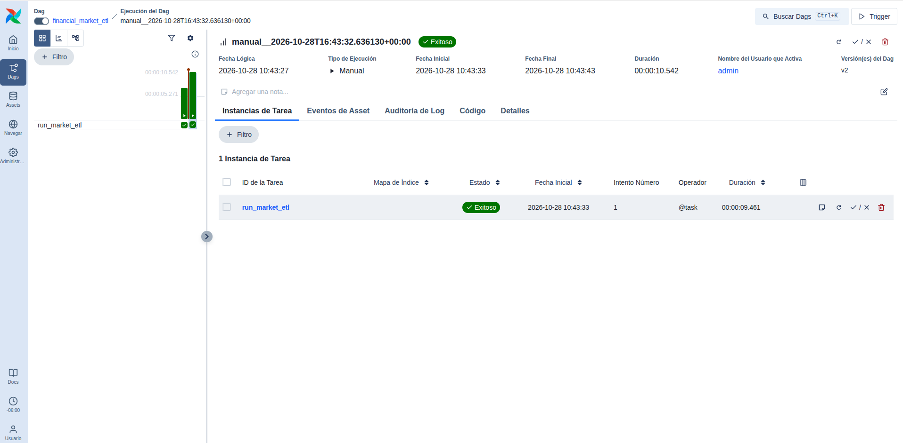
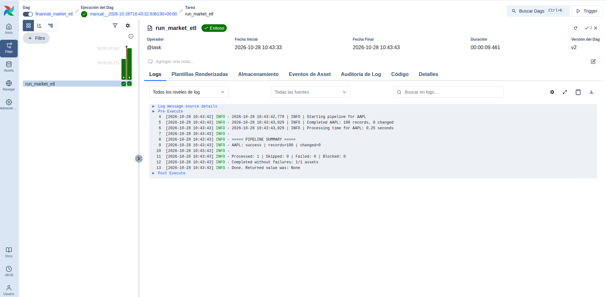
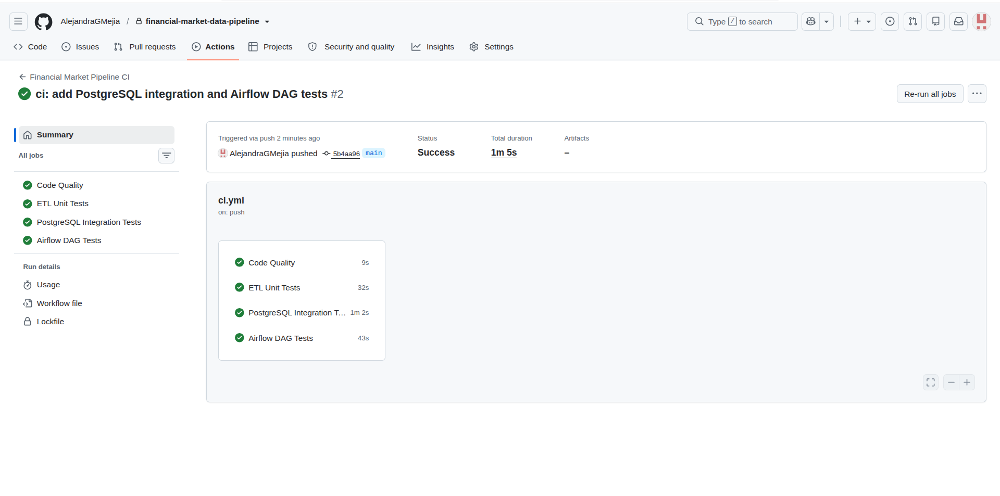

# Technical Report — Financial Market Data Pipeline

**Author:** Alejandra G. Mejía
**Project:** Data Engineering Portfolio — Project 02
**Reference date:** October 28, 2026
**Status:** Local implementation and CI validation completed; production deployment is out of scope.

## 1. Executive Summary

Financial Market Data Pipeline is a modular ETL solution that retrieves, validates, and stores daily financial market observations (OHLCV: open, high, low, close, and volume). It combines an external data provider—Alpha Vantage—with Python, local raw JSON preservation, and PostgreSQL 18. Apache Airflow 3.3.2 supports manually triggered local orchestration, while GitHub Actions provides automated code validation.

In the demonstrated execution, the pipeline processed **100 AAPL observations** by replaying saved JSON and made **zero changes** to previously loaded records. The verified suites comprise **61 ETL tests** and **4 Airflow DAG tests**. The expanded CI run on **October 28, 2026**, associated with commit `5b4aa96`, completed with **4 of 4 successful jobs**. These results support correctness and idempotence in the observed scenario; they do not establish production uptime, absolute financial-data accuracy, or production-scale performance.

## 2. Business Problem and Objectives

Financial analysis depends on consistent and traceable historical observations. Manual collection increases the likelihood of duplicates, inconsistent formats, invalid prices or volumes, and nonrepeatable processes. Public APIs also have usage limits that must be managed deliberately.

**Technical objectives:**

- Separate extraction, transformation, validation, and loading into maintainable components.
- Preserve original responses for reproducibility and inspection.
- Validate OHLCV observations before database persistence.
- Avoid redundant writes through transactional UPSERT operations.
- Control external API usage with freshness policies and a daily request budget.
- Expose execution history through Airflow and prevent regressions through CI.

## 3. Solution Architecture

The primary data path is **Alpha Vantage or saved JSON → Python client/reader → OHLCV transformation and validation → PostgreSQL**. The `run_pipeline.py` entry point coordinates these stages. Extraction, transformation, and loading remain independent from Apache Airflow.

**Architecture layers:**

| Layer | Technology | Responsibility |
|---|---|---|
| Ingestion | Python and Requests | Fetch from Alpha Vantage or read local JSON |
| Raw preservation | JSON files | Retain provider responses |
| Transformation | pandas | Convert daily series into structured records |
| Data quality | Python validators | Check OHLCV observations |
| Data and metadata | PostgreSQL 18 and SQLAlchemy | Transactional storage and ingestion state |
| Local infrastructure | Docker Compose | Run PostgreSQL |
| Orchestration | Apache Airflow 3.3.2 | Run offline ETL, inspect status and logs |
| Continuous integration | GitHub Actions | Run independent quality and test jobs |

Component, orchestration, CI, and error-propagation diagrams are available in [`architecture.md`](architecture.md).

## 4. ETL Implementation

### Extraction and replay

In `--source api` mode, the client retrieves daily series from Alpha Vantage. Responses are saved as JSON for inspection and replay. In `--source raw` mode, the application reads saved files for the requested symbol without contacting the provider. Multiple symbols can be handled in one run.

### Transformation and validation

The transformation layer converts source observations into chronologically ordered tabular records. OHLCV validation guards against intentionally loading invalid observations. Decimal-compatible representations support financial price precision.

### Loading and idempotence

The `daily_prices` table uses a composite `(symbol, date)` primary key. The loader performs transactional UPSERTs: new observations are inserted, while existing ones are updated only if their values differ. In the verified offline run, **100 records were processed and zero rows were changed**. This does not mean that 100 new observations were fetched in that run.

## 5. Data Model and Operational Metadata

| Table | Responsibility |
|---|---|
| `daily_prices` | Stores `symbol`, `date`, `open`, `high`, `low`, `close`, `volume`, and `updated_at` |
| `ingestion_state` | Records the last successful API fetch per symbol |
| `api_request_usage` | Tracks/reserves the local daily API request budget |

The schema is defined in `sql/001_create_daily_prices.sql`, `sql/002_create_ingestion_state.sql`, and `sql/003_create_api_request_usage.sql`.

## 6. API Usage Controls and Error Handling

Live ingestion supports a configurable freshness interval (24 hours by default) and a local daily budget (5 requests by default). Budget reservation is atomic. The `--force` option skips freshness checks **but does not bypass** the local API budget. If Alpha Vantage signals a rate limit, the pipeline records the outcome and blocks later provider requests within the same execution.

Each asset reports `success`, `skipped`, `failed`, or `blocked`. The CLI exits with **0** if no assets failed or were blocked, and **1** otherwise. This allows orchestration tools to recognize failed outcomes without relying on log text alone.

## 7. Apache Airflow Orchestration

The `financial_market_etl` DAG contains a `run_market_etl` task that invokes the existing ETL through `subprocess.run(..., check=True)`. Its observed configuration includes `schedule=None`, `catchup=False`, one maximum active run, zero retries, a five-minute task execution timeout, and a 240-second subprocess timeout.

The validated run was triggered manually from the dashboard and used `--source raw --symbols AAPL`, so **no Alpha Vantage requests were made**. Airflow reported success and captured the ETL output in task logs. Airflow Standalone and its SQLite metadata database are local development components, not production infrastructure.

## 8. Testing Strategy and Continuous Integration

The ETL suite contains **61 tests**, including unit tests and PostgreSQL integration tests. Four separate DAG tests validate configuration, offline command invocation, handling of a missing ETL environment, and subprocess failure propagation.

The `.github/workflows/ci.yml` workflow runs on pushes and pull requests targeting `main` and supports manual triggering. It defines four jobs:

| CI job | Scope |
|---|---|
| Code Quality | Ruff checks and Bash script syntax |
| ETL Unit Tests | Tests that do not require PostgreSQL integration |
| PostgreSQL Integration Tests | Temporary PostgreSQL, SQL schema application, full ETL test suite |
| Airflow DAG Tests | Isolated Airflow installation and four DAG tests |

The verified expanded CI run on **October 28, 2026** completed with **4/4 successful jobs**, with an overall elapsed time of approximately **1 minute and 5 seconds**. CI validates the implementation; it does not deploy or continuously operate the financial ingestion service.

## 9. Evidence and Verified Results

| Measure | Verified outcome |
|---|---|
| ETL tests | 61 passed |
| DAG tests | 4 passed |
| Total distinct tests | 65 |
| CI jobs | 4/4 successful |
| AAPL observations processed through offline Airflow run | 100 |
| Rows changed during repeat ingestion | 0 |
| Manual Airflow run state | Successful |

**Evidence screenshots:**

Screenshots document observed executions; they do not replace automated tests.

## 10. Design Decisions, Limitations, and Future Work

**Key decisions:** separate orchestration from ETL business logic, preserve original payloads, use idempotent database writes, explicitly manage API consumption, test against a real disposable PostgreSQL instance in CI, and isolate Airflow dependencies from the ETL environment.

**Current limitations:** manual offline Airflow runs, dependency on local Python environments for the DAG, local JSON datasets excluded from Git, provider API limits, and no cloud/production deployment, operational alerting, or long-term service metrics. Passing CI does not demonstrate continuous production operation.

**Potential next steps:** reproducible Airflow packaging and deployment, quota-aware live scheduling, robust secret management, alerts, data-freshness monitoring, and longitudinal execution metrics.

## 11. Conclusion

The project demonstrates the implementation and verification of a modular financial ETL pipeline with transactional persistence, idempotent loading, external API usage controls, local workflow orchestration, and automated GitHub validation. Its documented evidence supports the tested scenarios while clearly identifying the boundaries of the current implementation.

---

**Alejandra G. Mejía**
*Data Analyst | Aspiring Data Engineer*
[GitHub Profile](https://github.com/AlejandraGMejia)
