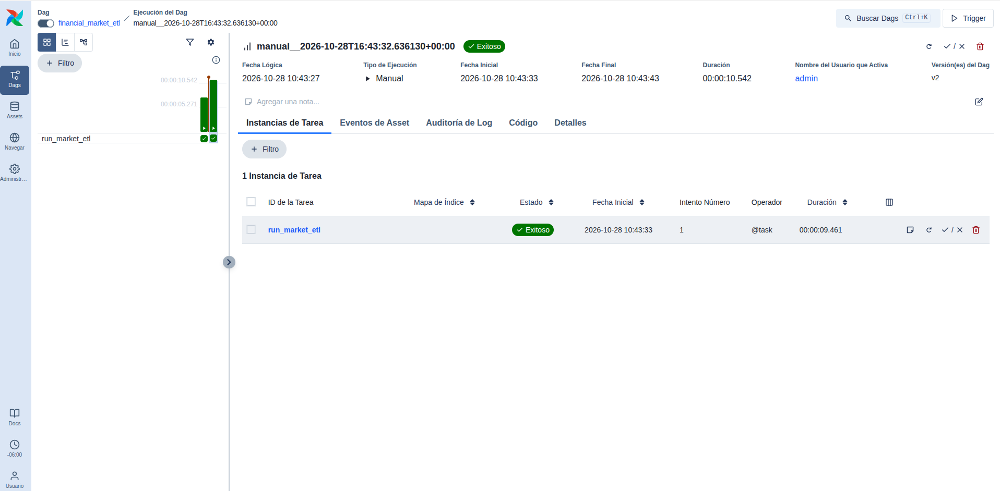
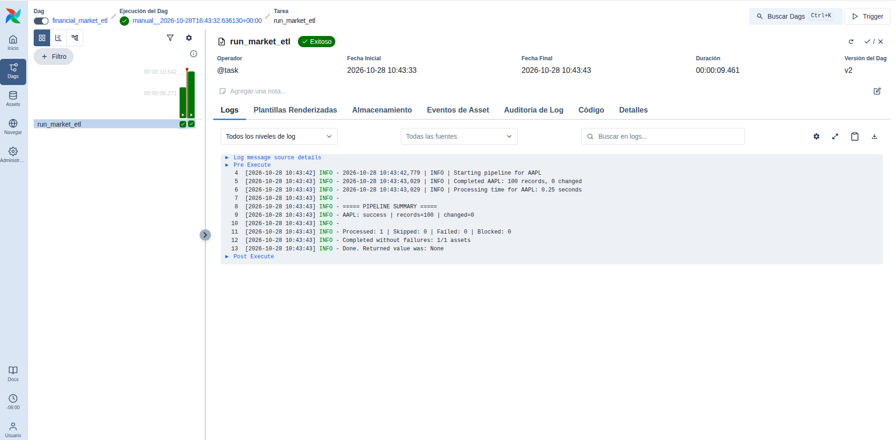
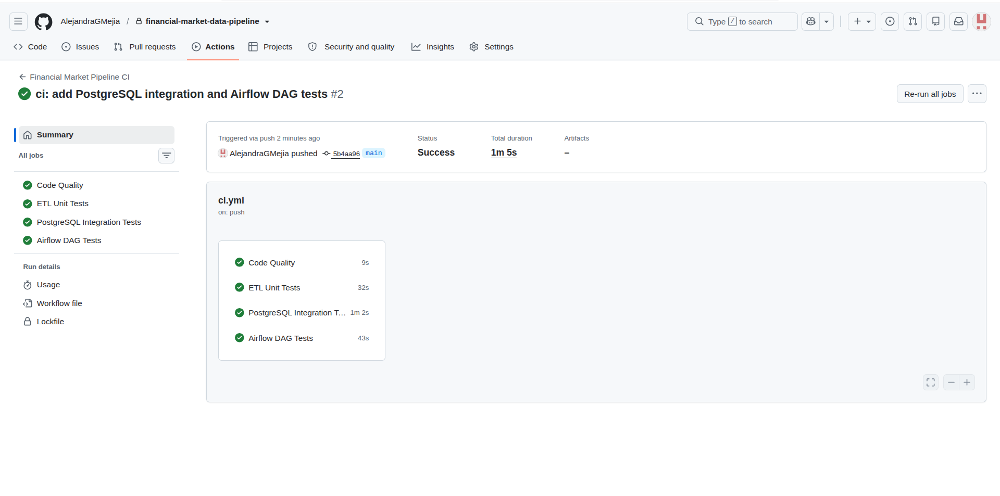

# Informe técnico — Financial Market Data Pipeline

**Autora:** Alejandra G. Mejía
**Proyecto:** Portafolio de Ingeniería de Datos — Proyecto 02
**Fecha de referencia:** 28 de octubre de 2026
**Estado:** Implementación local y validación CI completadas; despliegue productivo fuera del alcance actual.

## 1. Resumen ejecutivo

Financial Market Data Pipeline es una solución ETL modular para obtener, validar y almacenar observaciones diarias del mercado financiero (OHLCV: apertura, máximo, mínimo, cierre y volumen). Integra una fuente externa —Alpha Vantage—, Python, almacenamiento local de respuestas JSON y PostgreSQL 18. Incorpora Apache Airflow 3.3.2 para orquestación local manual y GitHub Actions para validación automática del código.

La implementación demostrada procesó **100 observaciones de AAPL** mediante reproducción de datos JSON guardados y realizó **cero cambios** sobre registros previamente cargados. Las suites verificadas comprenden **61 pruebas ETL** y **4 pruebas del DAG de Airflow**. La ejecución ampliada de CI del **28 de octubre de 2026**, vinculada al commit `5b4aa96`, terminó con **4 de 4 trabajos exitosos**. Estas evidencias demuestran funcionamiento e idempotencia en el escenario probado; no equivalen a garantías de disponibilidad, precisión financiera absoluta o rendimiento en producción.

## 2. Problema y objetivos

Los análisis financieros requieren datos históricos consistentes y trazables. La recopilación manual aumenta el riesgo de registros duplicados, formatos heterogéneos, errores en precios o volumen y dificultades para repetir procedimientos. Las API públicas también imponen límites que vuelven importante controlar la frecuencia de extracción.

**Objetivos técnicos:**

- Separar extracción, transformación, validación y carga en componentes mantenibles.
- Conservar respuestas originales para reproducibilidad y revisión.
- Aplicar controles de calidad a observaciones OHLCV antes de almacenarlas.
- Evitar modificaciones redundantes mediante operaciones UPSERT transaccionales.
- Controlar llamadas externas mediante frescura de datos y presupuesto diario.
- Proporcionar trazabilidad operativa mediante Airflow y prevención de regresiones mediante CI.

## 3. Arquitectura de la solución

El flujo de datos principal es: **Alpha Vantage o archivos JSON guardados → cliente/lector Python → transformación y validación OHLCV → PostgreSQL**. El ejecutable `run_pipeline.py` coordina las etapas. Los componentes de extracción, transformación y carga permanecen independientes de Apache Airflow.

**Capas y responsabilidades:**

| Capa | Tecnología | Responsabilidad |
|---|---|---|
| Ingesta | Python y Requests | Extracción desde Alpha Vantage o lectura de JSON local |
| Persistencia original | Archivos JSON | Conservar respuestas recibidas |
| Transformación | pandas | Convertir series diarias a registros estructurados |
| Calidad | Validadores Python | Verificar observaciones OHLCV |
| Datos y metadatos | PostgreSQL 18 y SQLAlchemy | Carga transaccional y estado de ingesta |
| Infraestructura local | Docker Compose | Ejecutar PostgreSQL |
| Orquestación | Apache Airflow 3.3.2 | Iniciar ETL offline, controlar estado y registrar logs |
| Integración continua | GitHub Actions | Ejecutar controles y pruebas en entornos independientes |

Los diagramas de componentes, orquestación, CI y propagación de errores se encuentran en [`architecture.md`](architecture.md).

## 4. Implementación del ETL

### Extracción y reproducción

En modo `--source api`, el cliente obtiene series diarias de Alpha Vantage. Las respuestas se conservan en archivos JSON para permitir análisis y repetición. En modo `--source raw`, la aplicación recupera el archivo disponible para el símbolo solicitado y evita utilizar la API. Puede recibir varios símbolos en una sola ejecución.

### Calidad y transformación

La transformación convierte observaciones de mercado en un conjunto tabular ordenado cronológicamente. La validación OHLCV previene la carga intencional de observaciones inválidas. El proyecto emplea representaciones compatibles con `Decimal` para preservar la precisión de precios financieros.

### Carga e idempotencia

La tabla `daily_prices` utiliza la clave primaria compuesta `(symbol, date)`. La carga emplea UPSERT transaccional: inserta observaciones nuevas y actualiza las existentes únicamente cuando su contenido cambia. Por eso, en la ejecución offline validada, 100 registros fueron procesados y **0 filas modificadas**. El resultado no significa que se descargaron 100 registros nuevos en esa ejecución.

## 5. Diseño de datos y metadatos operativos

| Tabla | Función |
|---|---|
| `daily_prices` | Almacena `symbol`, `date`, `open`, `high`, `low`, `close`, `volume` y `updated_at` |
| `ingestion_state` | Conserva la última extracción exitosa por símbolo |
| `api_request_usage` | Controla el consumo/reserva del presupuesto diario de API |

Los esquemas se definen en `sql/001_create_daily_prices.sql`, `sql/002_create_ingestion_state.sql` y `sql/003_create_api_request_usage.sql`.

## 6. Control de API y gestión de errores

Para ingestión en vivo, el pipeline permite establecer un período de frescura (24 horas por defecto) y un presupuesto local configurable (5 solicitudes diarias por defecto). La reserva del presupuesto se realiza de forma atómica. La opción `--force` omite el control de frescura, **pero no** el presupuesto. Si Alpha Vantage informa un límite de solicitudes, el pipeline registra el problema y bloquea intentos posteriores dentro de la misma ejecución.

Cada activo genera un resultado `success`, `skipped`, `failed` o `blocked`. La CLI devuelve código **0** si no hay activos fallidos ni bloqueados, y **1** en caso contrario. Esto permite que un orquestador identifique resultados fallidos en lugar de depender solo de mensajes impresos.

## 7. Orquestación con Apache Airflow

El DAG `financial_market_etl` contiene la tarea `run_market_etl` y ejecuta el proceso ETL existente mediante `subprocess.run(..., check=True)`. Sus características observadas incluyen `schedule=None`, `catchup=False`, un máximo de una ejecución activa, cero reintentos, límite de tarea de cinco minutos y timeout del subproceso de 240 segundos.

La ejecución validada se inició manualmente desde la interfaz y usó `--source raw --symbols AAPL`: **no realizó llamadas a Alpha Vantage**. Airflow registró una ejecución exitosa y logs con los resultados del ETL. Airflow Standalone y su base de metadatos SQLite corresponden a desarrollo local, no a una instalación productiva.

## 8. Estrategia de pruebas y CI

La suite ETL contiene **61 pruebas**, incluidas pruebas unitarias y de integración con PostgreSQL. Hay **4 pruebas independientes del DAG** que comprueban configuración, comando offline, ausencia del entorno ETL y propagación de errores de subproceso.

El workflow `.github/workflows/ci.yml` se activa ante `push` y pull requests dirigidos a `main`, además de permitir ejecución manual. Contiene cuatro trabajos:

| Trabajo de CI | Qué verifica |
|---|---|
| Code Quality | Ruff y sintaxis del script Bash |
| ETL Unit Tests | Pruebas que no requieren integración con PostgreSQL |
| PostgreSQL Integration Tests | Arranque temporal de PostgreSQL, aplicación de SQL y suite ETL completa |
| Airflow DAG Tests | Instalación aislada de Airflow y cuatro pruebas del DAG |

La ejecución ampliada verificada del **28 de octubre de 2026** tuvo **4/4 trabajos exitosos** y duración total aproximada de **1 minuto y 5 segundos**. CI valida la implementación, pero no despliega el servicio ni realiza ingestión financiera continua.

## 9. Evidencia y resultados

| Indicador | Resultado verificado |
|---|---|
| Pruebas ETL | 61 aprobadas |
| Pruebas del DAG | 4 aprobadas |
| Total de pruebas distintas | 65 |
| Trabajos CI | 4/4 exitosos |
| Observaciones AAPL procesadas mediante Airflow offline | 100 |
| Filas modificadas en la repetición | 0 |
| Estado de ejecución manual de Airflow | Exitoso |

**Capturas:**

Las capturas documentan las ejecuciones observadas; no sustituyen las pruebas automatizadas.

## 10. Decisiones, limitaciones y evolución

**Decisiones principales:** separación entre ETL y orquestador, preservación de datos originales, carga idempotente, control explícito de consumo API, pruebas de integración contra una base real y dependencias de Airflow aisladas del entorno ETL.

**Limitaciones actuales:** ejecución Airflow manual y offline, dependencias de entornos locales para el DAG, datos JSON locales no incluidos en Git, límite externo de Alpha Vantage, ausencia de despliegue cloud/productivo, alertas productivas y métricas de operación prolongada. Las pruebas de CI no demuestran funcionamiento continuo en producción.

**Posibles mejoras futuras:** empaquetado y despliegue reproducible del orquestador, planificación de ingesta API condicionada a cuotas, gestión segura de secretos, alertas, seguimiento de frescura de datos y métricas históricas de ejecución.

## 11. Conclusión

El proyecto demuestra la construcción y validación de un pipeline financiero ETL modular, con persistencia transaccional, comportamiento idempotente, control de llamadas externas, orquestación local y pruebas automatizadas en GitHub. Los resultados verificados respaldan el escenario de uso presentado y delimitan claramente lo que permanece fuera del alcance.

---

**Alejandra G. Mejía**
*Data Analyst | Aspiring Data Engineer*
[Perfil de GitHub](https://github.com/AlejandraGMejia)
